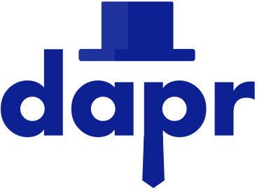
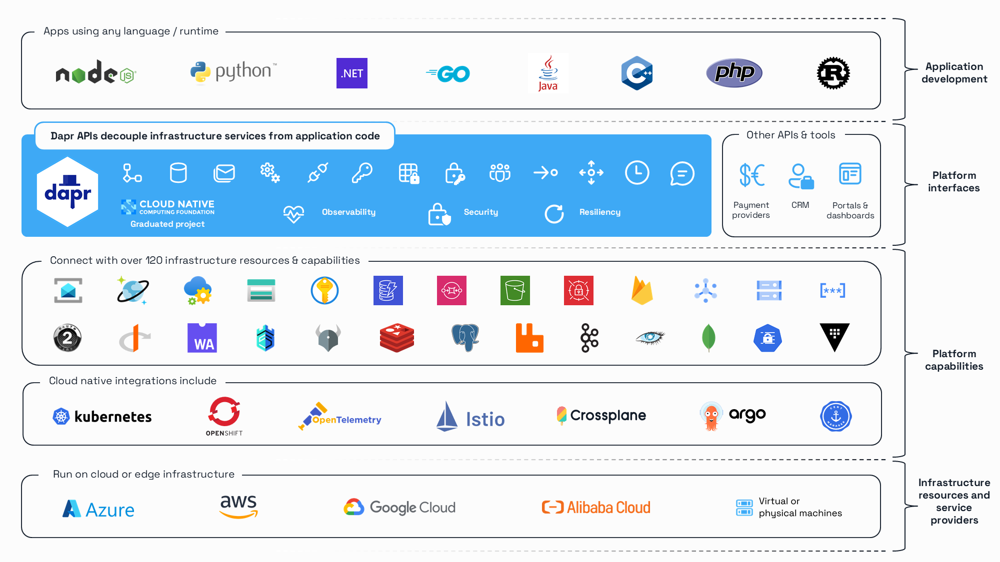

本文档是 [README.md](README.md) 的简体中文翻译，若两者有出入，以英文原版为准。

<div style="text-align: center">
<h2>面向持久执行、AI 智能体与安全分布式应用的运行时</h2>
</div>

[![Go Report][go-report-badge]][go-report-url] [![OpenSSF][openssf-badge]][openssf-url] [![Docker Pulls][docker-badge]][docker-url] [![Build Status][actions-badge]][actions-url] [![Test Status][e2e-badge]][e2e-url] [![Code Coverage][codecov-badge]][codecov-url] [![License: Apache 2.0][apache-badge]][apache-url] [![FOSSA Status][fossa-badge]][fossa-url] [![TODOs][todo-badge]][todo-url] [![Good First Issues][gfi-badge]][gfi-url] [![discord][discord-badge]][discord-url] [![YouTube][youtube-badge]][youtube-link] [![Bluesky][bluesky-badge]][bluesky-link] [![X/Twitter][x-badge]][x-link]

[go-report-badge]: https://goreportcard.com/badge/github.com/dapr/dapr
[go-report-url]: https://goreportcard.com/report/github.com/dapr/dapr
[openssf-badge]: https://www.bestpractices.dev/projects/5044/badge
[openssf-url]: https://www.bestpractices.dev/projects/5044
[docker-badge]: https://img.shields.io/docker/pulls/daprio/daprd?style=flat&logo=docker
[docker-url]: https://hub.docker.com/r/daprio/dapr
[apache-badge]: https://img.shields.io/github/license/dapr/dapr?style=flat&label=License&logo=github
[apache-url]: https://github.com/dapr/dapr/blob/master/LICENSE
[actions-badge]: https://github.com/dapr/dapr/workflows/dapr/badge.svg?event=push&branch=master
[actions-url]: https://github.com/dapr/dapr/actions?workflow=dapr
[e2e-badge]: https://img.shields.io/endpoint?url=https://gist.githubusercontent.com/dapr-bot/14e974e8fd6c6eab03a2475beb1d547a/raw/dapr-test-badge.json
[e2e-url]: https://github.com/dapr/dapr/actions?workflow=dapr-test&event=schedule
[codecov-badge]: https://codecov.io/gh/dapr/dapr/branch/master/graph/badge.svg
[codecov-url]: https://codecov.io/gh/dapr/dapr
[fossa-badge]: https://app.fossa.com/api/projects/custom%2B162%2Fgithub.com%2Fdapr%2Fdapr.svg?type=shield
[fossa-url]: https://app.fossa.com/projects/custom%2B162%2Fgithub.com%2Fdapr%2Fdapr?ref=badge_shield
[todo-badge]: https://badgen.net/https/api.tickgit.com/badgen/github.com/dapr/dapr
[todo-url]: https://www.tickgit.com/browse?repo=github.com/dapr/dapr
[gfi-badge]:https://img.shields.io/github/issues-search/dapr/dapr?query=type%3Aissue%20is%3Aopen%20label%3A%22good%20first%20issue%22&label=Good%20first%20issues&style=flat&logo=github
[gfi-url]:https://github.com/dapr/dapr/issues?q=is%3Aissue+is%3Aopen+label%3A%22good+first+issue%22
[discord-badge]: https://img.shields.io/discord/778680217417809931?label=Discord&style=flat&logo=discord
[discord-url]: http://bit.ly/dapr-discord
[youtube-badge]:https://img.shields.io/youtube/channel/views/UCtpSQ9BLB_3EXdWAUQYwnRA?style=flat&label=YouTube%20views&logo=youtube
[youtube-link]:https://youtube.com/@daprdev
[bluesky-badge]:https://img.shields.io/badge/Follow-%40daprdev.bsky.social-0056A1?logo=bluesky
[bluesky-link]:https://bsky.app/profile/daprdev.bsky.social
[x-badge]:https://img.shields.io/twitter/follow/daprdev?logo=x&style=flat
[x-link]:https://twitter.com/daprdev

Dapr 是一个用于构建分布式应用、工作流和 AI 智能体的开源运行时。它提供**持久执行**、安全的服务间通信、状态管理、事件驱动消息传递，以及一套可在任何地方运行的一致 API——无论是 Kubernetes、云端、边缘，还是你的笔记本电脑。

无论你是在构建 AI 智能体、关键业务工作流、微服务，还是事件驱动系统，Dapr 都能让你专注于业务逻辑，而不是底层管道设施。Dapr 以边车（sidecar）方式运行，因此*任何*语言都可以通过标准的 HTTP 和 gRPC 使用它的每一项能力，并且为 **.NET、Java、Python、Go、JavaScript/TypeScript 和 Rust** 提供了原生 SDK——没有框架锁定，也无需编写样板代码即可达到生产级的可靠性、安全性与可观测性。



## 为什么选择 Dapr？

现代应用不再是简单的请求/响应服务。它们是长时间运行的工作流、AI 智能体、事件驱动管道、多智能体系统以及人工介入（human-in-the-loop）流程——并且必须在生产环境中经受住故障、保持状态、安全通信。

可靠地构建这一切非常困难。Dapr 将经过验证的模式和久经考验的构建块整合为一个一致的编程模型，让你不必为发布的每个服务重新发明持久性、安全性或消息传递。你永远不会直接接触线程、分区或重试逻辑等底层原语——并且可以在平台和底层基础设施之间无缝迁移，而无需重写代码。平台团队使用 Dapr 提供治理和黄金路径（golden paths），应用团队则获得在任何地方都以相同方式工作的简单 API。

## 持久执行

应用会出故障，基础设施会重启，网络会分区。当这些情况发生时，你的工作流和智能体不应丢失进度。

**Dapr Workflows** 提供持久执行能力，自动保存进度，并在以下情况之后从最后一个已完成的步骤恢复：

- 进程崩溃
- Pod 重启
- 节点故障
- 滚动部署
- 基础设施中断

执行不必从头开始，而是精确地从上次中断的地方继续——无需额外编写数据库或状态机代码。你用所选语言以普通代码的形式编写工作流；如果应用在中途崩溃，Dapr 会自动恢复，并从下一个未完成的步骤继续执行。

**常见用例：** AI 智能体、客户入驻、订单处理、人工审批流程、文档处理，以及其他多步骤业务流程。

使用面向 .NET、Java、Python、Go、JavaScript/TypeScript 和 Rust 的 Dapr SDK 编写工作流。工作流引擎为你提供：

- **工作流模式**：任务链、扇出/扇入（fan-out/fan-in）、监控器、基于外部事件的人工介入，以及补偿
- **持久定时器、重试策略和子工作流**
- **多应用工作流**：一个工作流可以调用由其他 Dapr 应用托管的活动（activity）和子工作流
- **版本管理**：在实例运行期间更改工作流代码
- **通过 API 和 `dapr workflow` CLI 进行管理**：列出、查看历史、挂起、恢复、终止、重新运行、触发事件和清除
- **访问策略**：设定哪些应用可以调用哪些工作流和活动

阅读[工作流概览](https://docs.dapr.io/developing-applications/building-blocks/workflow/workflow-overview/)、[工作流模式](https://docs.dapr.io/developing-applications/building-blocks/workflow/workflow-patterns/)和[多应用工作流](https://docs.dapr.io/developing-applications/building-blocks/workflow/workflow-multi-app/)，或从[工作流快速入门](https://docs.dapr.io/getting-started/quickstarts/workflow-quickstart/)开始。

## 构建可靠的 AI 智能体

AI 智能体需要的远不止模型推理。要在生产环境中运行，它们需要状态、编排、恢复、安全通信和治理。

Dapr 提供可靠运行智能体所需的运行时原语——并可与你现有的 AI 框架和模型协同工作：

- **持久的智能体执行**，在崩溃和重启后依然存续
- 由 Workflows 支撑的**长时间运行的多步骤任务**
- **多智能体编排**和智能体间通信
- **状态持久化**以及跨交互的记忆
- 通过 Conversation API 实现 **LLM 集成**，支持提示词缓存和工具调用
- **人工介入审批**和事件驱动协调
- 故障后的**自动恢复**

## 默认安全

每个 Dapr 应用都会获得一个可加密验证的身份。安全性是内建的，而非事后附加：

- 所有服务间流量均使用双向 TLS（mTLS）
- 工作负载身份与认证
- 细粒度、最小权限的授权策略
- 由你偏好的密钥保管库（vault）支撑的密钥管理
- 自动证书签发与轮换
- 零信任通信

精确控制哪些应用、智能体和服务可以相互通信：

```yaml
apiVersion: dapr.io/v1alpha1
kind: Configuration
metadata:
  name: access-policy
spec:
  accessControl:
    defaultAction: deny
    policies:
      - appId: orders
        defaultAction: allow
```

在整个环境中实施最小权限访问控制，而无需编写自定义安全基础设施。

## 可验证执行

对许多系统而言，知道工作*已完成*还不够——你需要证明它是*如何*完成的。

基于 Dapr 的加密工作负载身份和持久工作流历史，可验证执行提供以下证据：

- 工作源自何处，以及由哪个身份执行
- 执行的顺序与沿袭（lineage）
- 输入和输出的真实性
- 执行历史是否被篡改

这使得工作流和 AI 系统可审计，能够证明完整性、真实性和来源——非常适合金融服务、医疗、政府及其他对合规敏感的环境。

## 分布式应用 API

持久执行和 AI 构建在支撑 Dapr 微服务的同一套经过验证的构建块之上。按需混搭使用：

| API | 功能 |
|:----|:-------------|
| **Workflows（工作流）** | 以代码形式编写长时间运行的持久工作流和智能体流程 |
| **Service Invocation（服务调用）** | 可靠、安全的服务间调用，内建 mTLS、重试和可观测性 |
| **State Management（状态管理）** | 在数十种存储中持久化和查询状态，而不与某个数据库耦合 |
| **Pub/Sub（发布/订阅）** | 在你偏好的消息代理上构建事件驱动系统，保证至少一次投递 |
| **Actors（参与者）** | 构建有状态的、基于虚拟 actor 的应用 |
| **Conversation（对话）** | 通过一致的 API 调用 LLM，支持提示词缓存和工具调用 |
| **Bindings（绑定）** | 由外部系统触发你的代码，并向外部系统发送事件 |
| **Secrets（密钥）** | 从外部密钥存储安全地获取机密信息 |
| **Configuration（配置）** | 以一致的方式读取和订阅应用配置 |
| **Distributed Lock（分布式锁）** | 安全地协调对共享资源的访问 |
| **Cryptography（加密）** | 加密和解密数据，而不向应用暴露密钥 |
| **Jobs（任务调度）** | 调度立即执行或将来执行的工作 |

所有 API 均可通过 HTTP 和 gRPC 使用，并提供 Java、.NET、Go、JavaScript、Python、Rust、C++ 和 PHP 的 SDK。你可以获得内建的[可观测性](https://docs.dapr.io/concepts/observability-concept/)、可靠性，以及跨 Azure、AWS 和 GCP 的可插拔、厂商中立的组件，涵盖状态存储、消息代理等。

## 随处运行

Dapr 以边车（容器或进程）方式运行在你的应用旁边，并在以下环境中以完全相同的方式工作：

- Kubernetes
- AWS、Azure 和 Google Cloud
- 虚拟机和裸金属
- 边缘和 IoT 环境
- 物理隔离（air-gapped）部署

它非常轻量（约 58MB 的二进制文件，占用约 4MB 内存），通过 HTTP 和 gRPC 支持所有编程语言，且在平台之间迁移时无需修改应用代码。可以逐个 API 渐进式采用，没有运行时锁定。

## 生产环境值得信赖

Dapr 是云原生计算基金会（CNCF）的**毕业（graduated）**项目，被世界各地的组织用于构建关键业务应用。团队选择 Dapr 来自动从故障中恢复、构建可靠的 AI 系统、保护服务间通信、简化分布式架构，并避免基础设施锁定。

<p align="center"></p>

## 快速上手

请参阅我们文档中的[快速上手（Getting Started）](https://docs.dapr.io/getting-started/)指南。

## 快速入门与示例

* 查看[快速入门仓库](https://github.com/dapr/quickstarts)，获取帮助你上手 Dapr 的代码示例。
* 在 Dapr [示例仓库](https://github.com/dapr/samples)中探索更多示例。

## 社区
我们期待你的贡献和建议！最简单的参与方式之一，就是参加邮件列表讨论、在即时通讯中交流，或参加每两周一次的社区例会。
有关社区参与、开发者与贡献指南等更多信息，请前往 [Dapr 社区仓库](https://github.com/dapr/community#dapr-community)。

### 联系我们

有任何问题都可以联系我们，我们会尽快回复！

| 平台  | 链接        |
|:----------|:------------|
| 💬 Discord（首选） | [](https://aka.ms/dapr-discord)
| 💭 LinkedIn | [@daprdev](https://www.linkedin.com/company/daprdev)
| 🦋 BlueSky | [@daprdev.bsky.social](https://bsky.app/profile/daprdev.bsky.social)
| 🐤 Twitter | [@daprdev](https://twitter.com/daprdev)


### 社区例会

我们每两周举办一次社区例会，展示新功能、回顾即将到来的里程碑，并进行问答。欢迎所有人参加！

📞 访问[即将举行的 Dapr 社区例会](https://github.com/dapr/community/issues?q=is%3Aissue%20state%3Aopen%20label%3A%22community%20call%22)查看日程和会议链接。

📺 访问 https://www.youtube.com/@DaprDev/streams 观看往期社区例会直播。

### 视频与播客

我们提供了各种主题演讲、播客和演示文稿，供你参考学习。

📺 访问 https://docs.dapr.io/contributing/presentations/ 查看往期演讲和幻灯片，或访问我们的 YouTube 频道 https://www.youtube.com/@DaprDev/videos。

### 参与 Dapr 贡献

请参阅[开发指南](https://docs.dapr.io/contributing/)，开始构建和开发。

## 代码仓库

| 仓库 | 描述 |
|:-----|:------------|
| [Dapr](https://github.com/dapr/dapr) | 你当前所在的主仓库。包含 Dapr 运行时代码和概览文档。
| [CLI](https://github.com/dapr/cli) | Dapr CLI 让你在本地开发机或 Kubernetes 集群上安装 Dapr，提供调试支持，并启动和管理 Dapr 实例。
| [Docs](https://docs.dapr.io) | Dapr 的文档。
| [Quickstarts](https://github.com/dapr/quickstarts) | 该仓库包含一系列简单的代码示例，展示 Dapr 的主要能力。
| [Samples](https://github.com/dapr/samples) | 该仓库存放由社区维护的、面向各种 Dapr 用例的示例。
| [Components-contrib](https://github.com/dapr/components-contrib) | components contrib 旨在提供开放、社区驱动的可复用组件，用于构建分布式应用。
| [Go-sdk](https://github.com/dapr/go-sdk) | Dapr 的 Go SDK
| [Java-sdk](https://github.com/dapr/java-sdk) | Dapr 的 Java SDK
| [JS-sdk](https://github.com/dapr/js-sdk) | Dapr 的 JavaScript SDK
| [Python-sdk](https://github.com/dapr/python-sdk) | Dapr 的 Python SDK
| [Dotnet-sdk](https://github.com/dapr/dotnet-sdk) | Dapr 的 .NET SDK
| [Rust-sdk](https://github.com/dapr/rust-sdk) | Dapr 的 Rust SDK
| [Cpp-sdk](https://github.com/dapr/cpp-sdk) | Dapr 的 C++ SDK
| [PHP-sdk](https://github.com/dapr/php-sdk) | Dapr 的 PHP SDK


## 行为准则

请参阅我们的 [Dapr 社区行为准则](https://github.com/dapr/community/blob/master/CODE-OF-CONDUCT.md)