**Test environment:** Azure AKS, 3x Standard_D2s_v6 (2 vCPU, 8 GiB) Linux nodes

### Throughput per resource

Iterations/sec relative to the CPU and memory consumed by the app and its Dapr sidecar combined.
Resource figures are point-in-time samples taken at the end of each run: memory is steady-state and comparable across runs, but treat the per-core column as indicative only until resource usage is sampled continuously during the run.

| Test | Iterations/sec | App CPU (m) | App Mem (MB) | Sidecar CPU (m) | Sidecar Mem (MB) | Iter/s per core | Iter/s per GB |
| --- | --- | --- | --- | --- | --- | --- | --- |
| TestBulkPubsubPublishGrpcPerformance_In-memory_with_with_cloud_event | 199.94 | 291 | 40 | 1174 | 80 | 136.5 | 1708.4 |
| TestBulkPubsubPublishGrpcPerformance_In-memory_without_cloud_event_(raw_payload) | 199.95 | 245 | 40 | 830 | 80 | 186.0 | 1715.5 |
| TestBulkPubsubPublishGrpcPerformance_Kafka_with_cloud_event | 199.70 | 233 | 43 | 1170 | 92 | 142.3 | 1509.6 |
| TestBulkPubsubPublishGrpcPerformance_Kafka_without_cloud_event_(raw_payload) | 199.92 | 567 | 45 | 1464 | 94 | 98.4 | 1471.1 |

### TestBulkPubsubPublishGrpcPerformance_In-memory_with_with_cloud_event

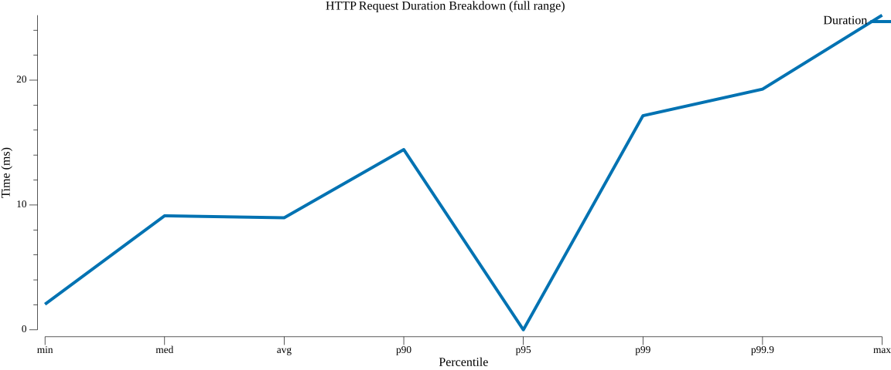
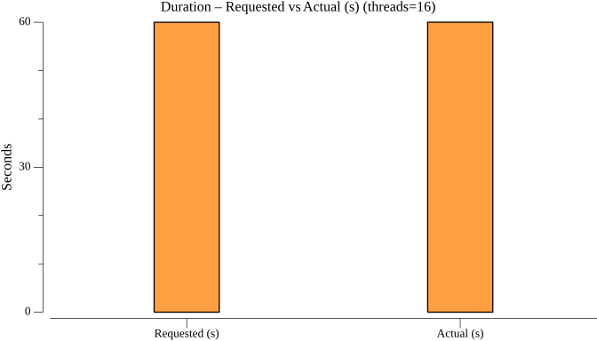
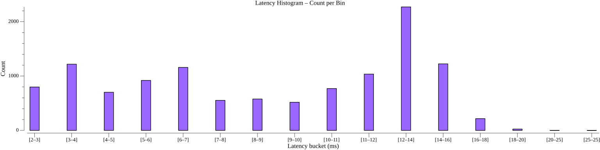
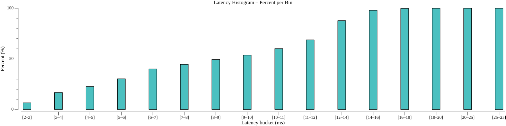

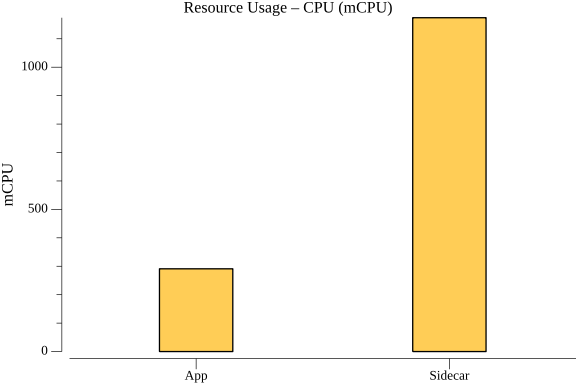

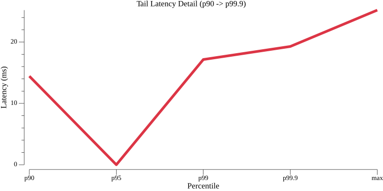

### TestBulkPubsubPublishGrpcPerformance_In-memory_without_cloud_event_(raw_payload)

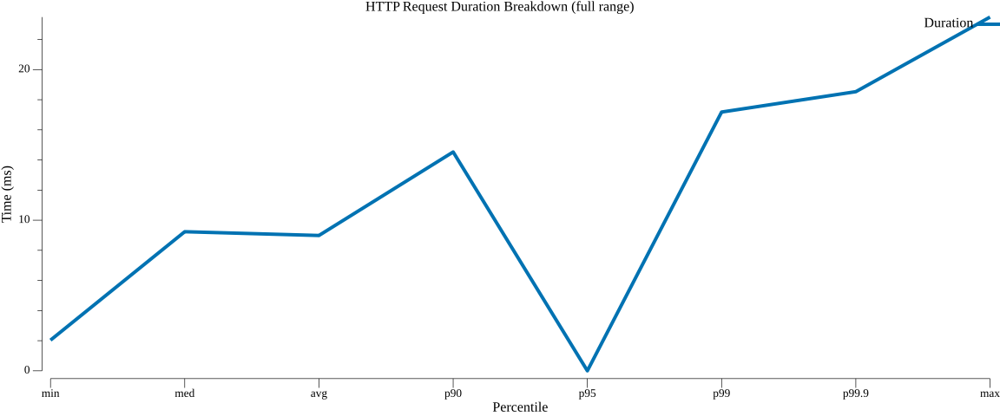

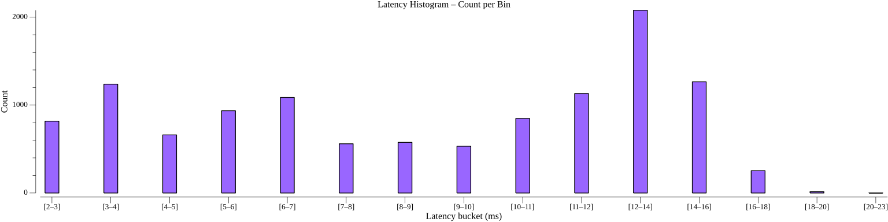
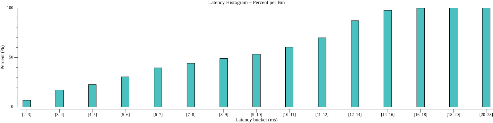
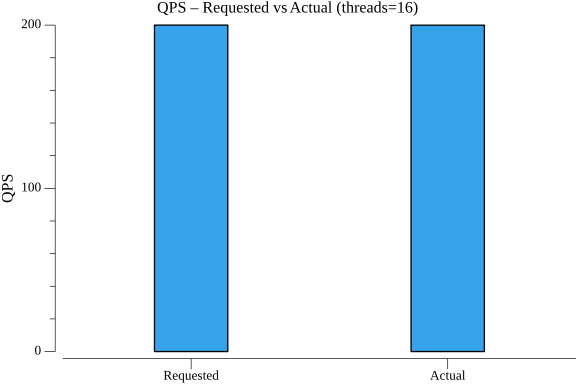
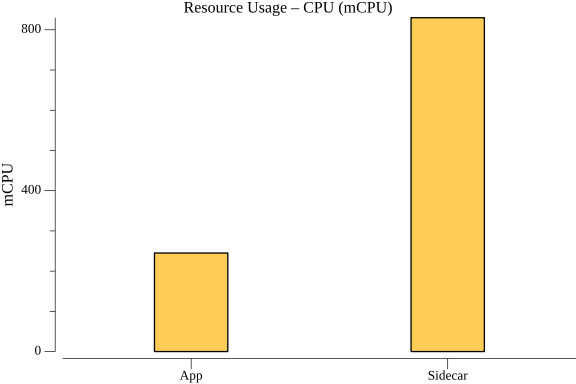
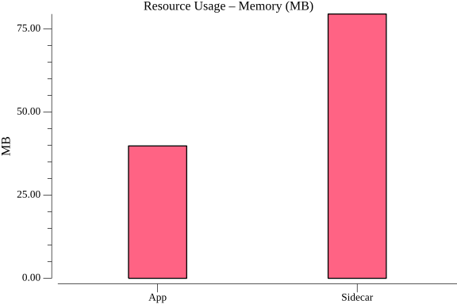

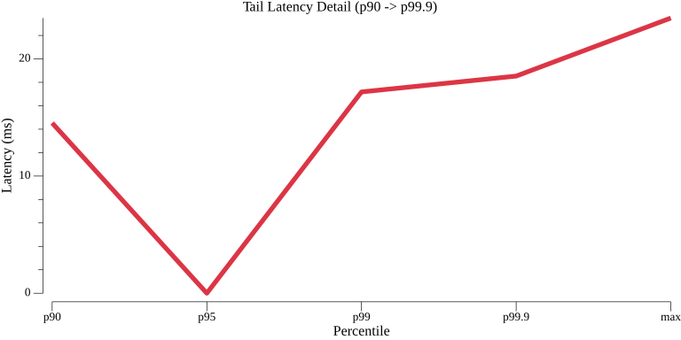

### TestBulkPubsubPublishGrpcPerformance_Kafka_with_cloud_event

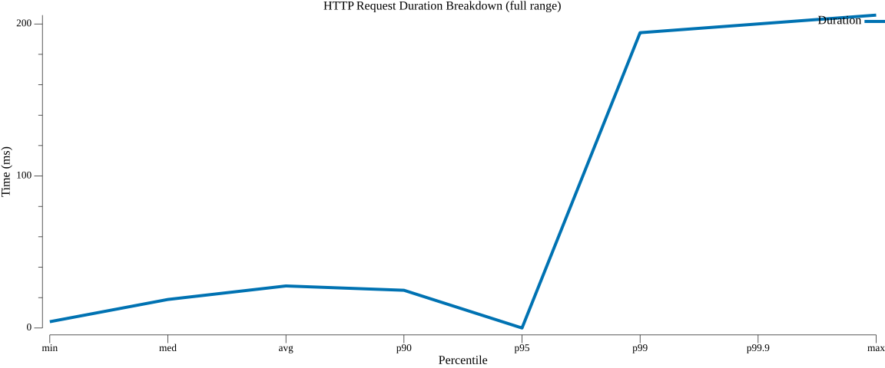

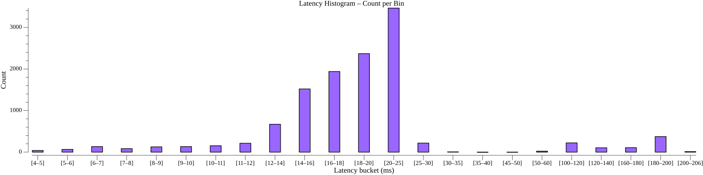
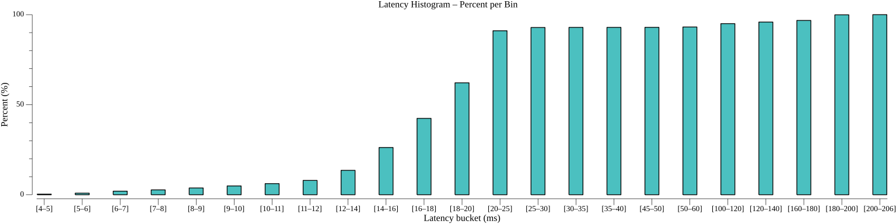
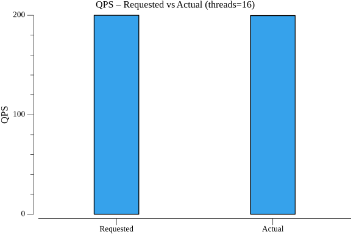
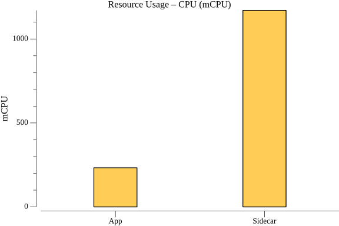
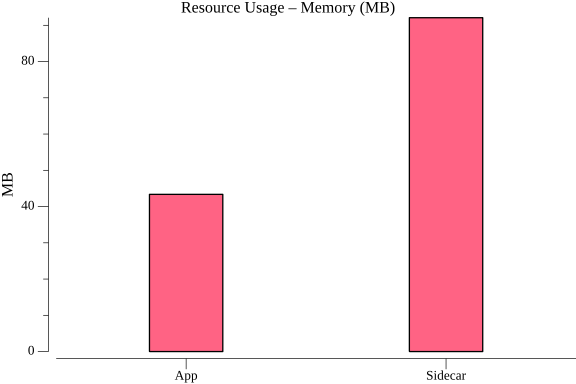
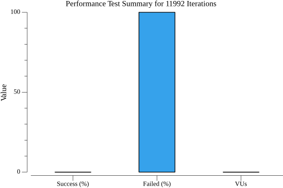
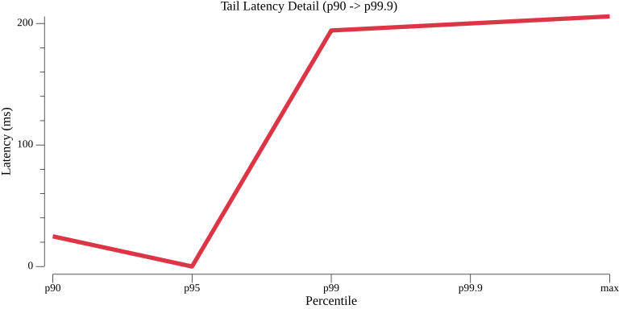

### TestBulkPubsubPublishGrpcPerformance_Kafka_without_cloud_event_(raw_payload)

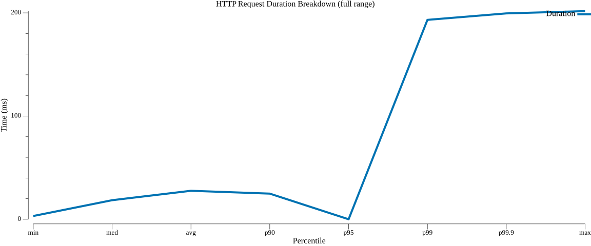

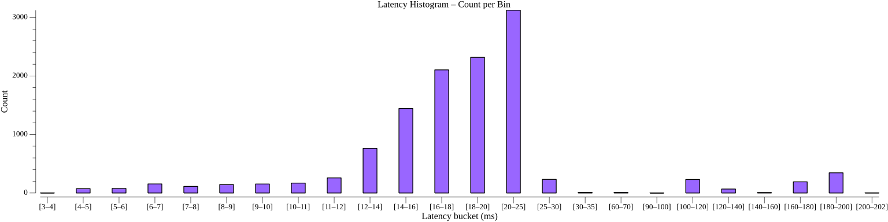
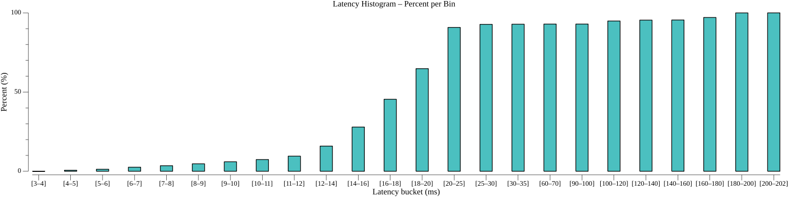

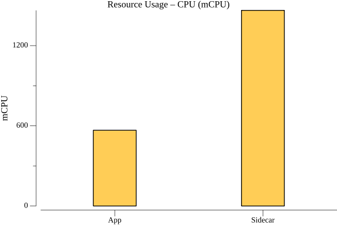

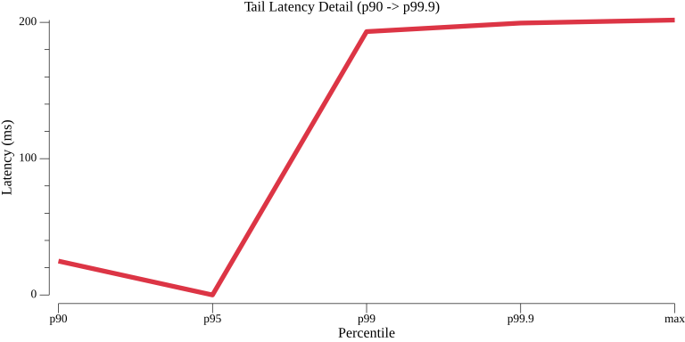

### TestBulkPubsubPublishGrpcPerformance_variants_duration

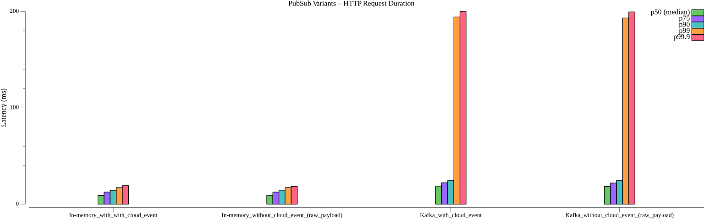
